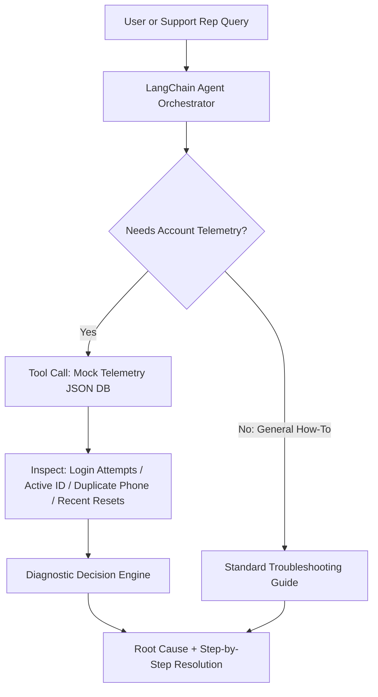

# Agentic Website & Login Troubleshooting Copilot

> **Business Problem:** Authentication and account-access issues ("I can't log in", "I never got my reset code") drive 20–30% of Tier-1 contact center call volume. Reps waste minutes cross-referencing separate admin tables to check lockout counters, duplicate phone numbers, or expired reset tokens. This tool-calling copilot queries account telemetry automatically to diagnose root causes in seconds.

[](YOUR_YOUTUBE_LINK_HERE)


-orange)


---

## System Architecture & Tool-Calling Flow



## Diagnostic Scenarios Handled
Instead of offering generic "clear your browser cache" advice, the agent inspects structured user telemetry records to pinpoint the exact blocker:
* **Account Lockout (`failed_login_attempts >= 5`):** Identifies active security lockout, verifies cooldown window, and instructs the rep/user on unlock verification.
* **Duplicate Phone Number Conflict (`duplicate_phone_flag: true`):** Detects when SMS 2FA/reset codes fail because a mobile number is tied to multiple legacy user IDs.
* **Recent Password Reset Cooldown (`last_password_reset_minutes < 15`):** Prevents redundant reset loops when email delivery is delayed or an older link was clicked out of order.
* **Inactive / Unverified Profile (`account_status != "active"`):** Flags pending email onboarding versus genuine credential errors.

---

## Tech Stack
* **Orchestration:** LangChain (Tool-Calling / Agent execution loop)
* **LLM Provider:** Groq API (`llama3-70b-8192`)
* **Telemetry Layer:** Structured Mock JSON User Telemetry Database
* **Frontend:** Streamlit interactive diagnostic console
* **Environment Management:** `python-dotenv`

---

## Known Limitations & Production Guardrails
1. **Read-Only Diagnostic Execution:** By design, this agent only possesses **read-only** telemetry lookup tools. In customer support operations, autonomous write actions (such as unlinking a duplicate phone number or overriding a 2FA lockout) present social-engineering risks and require authenticated human confirmation or step-up identity verification.
2. **Mock Telemetry Data:** Uses a local JSON datastore simulating realistic enterprise auth logs. Production deployment replaces the local JSON loader with authenticated REST endpoints (Okta, Auth0, or internal user-service APIs).
3. **Context Window Hygiene:** Conversation history is scoped to the active troubleshooting session to prevent cross-account data bleed between consecutive support tickets.

---

## Quickstart & Local Setup

```bash
# 1. Clone the repository
git clone [https://github.com/okrao/website_troubleshooter.git](https://github.com/okrao/website_troubleshooter.git)
cd website_troubleshooter

# 2. Create and activate virtual environment
python3 -m venv venv
source venv/bin/activate

# 3. Install dependencies
pip install -r requirements.txt

# 4. Configure environment variables
cp .env.example .env
# Add your GROQ_API_KEY inside .env

# 5. Launch the Troubleshooting Copilot
streamlit run app.py
```